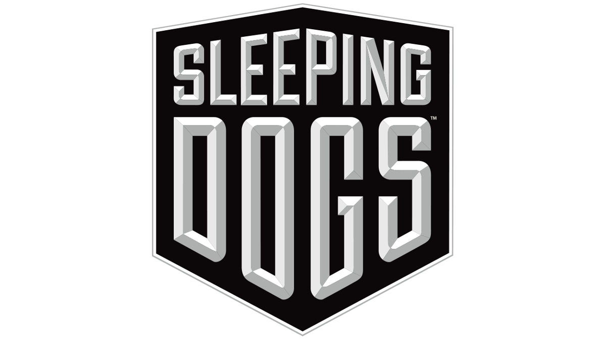

### Xbox 360 static recompilation for Nintendo Switch

The Xbox 360 release of **Sleeping Dogs**, lifted instruction by instruction to C++ with
[ReXGlue](https://github.com/rexglue/rexglue-sdk) and running natively on the Switch, drawn by its own Vulkan renderer.

[Features](#-features) · [Status](#-status) · [Performance](#-performance) · [Renderer](#-the-native-renderer) · [Building](#%EF%B8%8F-building) · [Roadmap](#%EF%B8%8F-roadmap) · [Legal](#%EF%B8%8F-legal)

---

> [!WARNING]
> **Early work in progress, not playable yet.** The game boots, plays its videos and reaches gameplay on a real
> console, but runs at 6–7 fps there and crashes after a few minutes. There is no prebuilt NRO.

> [!IMPORTANT]
> **No game data is included.** You need your own copy of the Xbox 360 disc. The recompiled code, the shader
> library and the NRO are made on your computer from it.

## ✨ Features

- 🧠 **Native code**: the retail executable (`default.xex`) recompiled to AArch64 with ReXGlue on a Switch fork of
  its SDK (devkitA64, libnx, Mesa NVK as the Vulkan driver).
- 🎨 **Native renderer** (`renderer/`): the game's Xenos command stream drawn directly with Vulkan, shaders
  translated ahead of time, instead of emulating the Xenos GPU. Developed and tested on a Windows bench that runs the
  same renderer, then built into the NRO unchanged.
- 🎬 **Videos** (Square Enix / UFG logos, cutscenes), **audio** through the SDK's XMA decoder.
- 🎮 **Switch branding patch** (`port/tools/apply_branding.py`): "Xbox 360" texts and button glyphs replaced by
  Nintendo Switch ones in your data files.
- ⏱️ **Frame limit** 30 / 60 / unlimited (`sdretail.toml`), measured fps in the log.
- 🔬 **Tooling**: data formats (`.big`/`.bix` archives, text tables, textures), offline shader library builder,
  bench automation (recorded input replay to gameplay, frame dumps), Switch profile symbolizer.

## 📊 Status

| Area | State |
| --- | --- |
| Boot, menus, intro videos | ✅ Work on the console |
| Gameplay | ⚠️ Reached on the console (night market); crashes after 2–5 minutes in a game worker thread (allocator pool corruption, under investigation) |
| Rendering (bench) | ✅ Lighting, composite, haze, floor, instancing, shadows and post-processing match the Xenos emulation |
| Rendering (console) | ⚠️ Same renderer; shadows reported too dark (filtering of depth formats on NVK suspected) |
| Audio | ✅ Works, no delay |
| Performance | ❌ 6–7 fps in gameplay at stock clocks (target: 30) |
| Branding patch | ⚠️ Text and buttons ready, not yet checked in game |

Fixed lately: the dark filter with a lit strip at the right edge (Xenos clears a color target through its depth
alias; now mirrored), black intro videos, white floor (CTX1 normal maps, packed normals, cube faces), spikes from
manually instanced meshes (vertex pulling), the black frame (shader translator RCP/LOG clamps, resolve R/B swap).

The full history, with every measurement and decision, is in [portlog.md](portlog.md) (Russian).

## ⚡ Performance

Handheld, stock clocks (CPU 1224 MHz, GPU 614 MHz), build 0.1.0:

| Scene | Draws per frame | fps |
| --- | --- | --- |
| Menus, loading | 150–460 | 20–30 |
| Cutscene | ~1100 | 9 |
| Gameplay, night market | 4000–4300 | 6.5–7 |

Where the time goes (console profile): the three cores are 86 % busy, no thread at 100 %. The GPU command thread
takes ~67 % of a core (~12 µs per draw plus ~100 ms per frame of fixed work); four game worker threads take ~30 %
each, almost all of it spinning in Direct3D's fence wait, which on the Xbox 360 yields to the other hardware thread
and here burns a core; audio (Wwise) takes ~29 %. On the bench (RTX 3070 Ti) the same frame takes 2.8 µs per draw.

## 🎨 The native renderer

`renderer/` is a Vulkan backend for ReXGlue that replaces the emulation of the Xenos GPU for this game. It is a
snapshot of the backend as developed in the SDK fork (`port/tools/export_renderer.ps1`), meant to be reusable by
other Xbox 360 ports on the same SDK:

- **Shaders ahead of time**: every Xenos shader of the game translated by XenosRecomp (`nx/shaders`) to HLSL and
  SPIR-V (DXC) into a package looked up by microcode hash at run time; vertex fetches with computed indices
  (manual instancing) read their buffers in the shader (vertex pulling).
- **EDRAM-lite**: render targets as host images keyed by EDRAM base and pitch in samples, resolves as copies into
  host textures (with the copy's R/B swap and exponent bias), depth restore, depth-as-color clears.
- **Geometry**: index and vertex ranges copied once into a persistent buffer and found again by content hash,
  hashed at most once per frame; packed normals (10:11:11) repacked.
- **Textures**: tiled and compressed formats (DXT, CTX1 to R8G8), page write watches plus content hash, cube
  faces assembled from resolves, bindless descriptors.
- **Recording**: only state changes are recorded, occlusion queries answered from host queries.

## 🛠️ Building

Not packaged for others yet; the steps are written down for this machine in [docs/repro.md](docs/repro.md) and
[docs/switch-bringup.md](docs/switch-bringup.md) (Russian). In short:

1. Extract the disc (`port/tools/extract_iso.py`) and the game's shader containers (`port/tools/sdshaders.py`).
2. Build the shader library (`port/tools/shaderlib/build_shaderlib.sh`, WSL: XenosRecomp + DXC).
3. Generate the recompiled code and build the NRO in the devkitA64 Docker image (`nx/tools/sd_codegen.sh`,
   `nx/tools/sdnx_sync_sdk.sh`, `nx/tools/sd_build_nro.sh`) against the Switch SDK and a Mesa NVK build for Horizon.
4. Copy `sdretail.nro`, `sdretail.toml` and `sdnx_shaders/` to `sdmc:/switch/sdretail/` together with your game data.

`nx/desktop` builds the same game for Windows with the same renderer: the bench where rendering is debugged.

## 🗺️ Roadmap

1. **Console crash** in the game's worker threads (allocator pool `0x82F73A74`).
2. **CPU**: let the fence-wait spin yield the core; frame lag on the fence wait (wait for the previous frame);
   cheaper register writes and draw setup on the GPU thread; guest registers as C++ locals in the generated code;
   guest clock without a mutex; native audio DSP.
3. **GPU**: 540p option, render scale; check shadow filtering on NVK.
4. A deko3d backend for the renderer (lower driver overhead on the Switch) once the CPU side is under control.

## ⚖️ Legal

Unofficial fan project with no affiliation to Square Enix, United Front Games or Nintendo. "Sleeping Dogs" and its
logo are trademarks of their respective owners. You provide your own legally obtained copy of the game; nothing
derived from it is in this repository, and no prebuilt NRO is published. Running homebrew requires custom firmware,
which violates Nintendo's terms and can get a console banned.

The code of this repository is under the [MIT license](LICENSE). Third-party components and their licenses:
[THIRD_PARTY_NOTICES.md](THIRD_PARTY_NOTICES.md).
